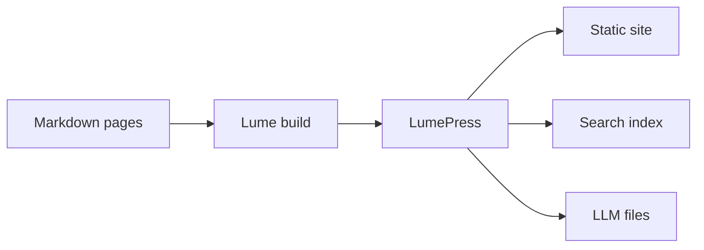

# Markdown Extensions

LumePress supports VitePress's markdown extensions with the same syntax. Each section below shows the markdown you write and what it renders, live, on this page.

## Header Anchors

Headings get anchor links automatically. Hover a heading on this page to see its `#` permalink.

### Custom Anchors

To set a heading's anchor yourself instead of generating it from the text, add a suffix:

```md
# Using custom anchors {#my-anchor}
```

This links to `#my-anchor` instead of the default `#using-custom-anchors`.

## Links

### Internal Links

Link to other pages with absolute or relative paths. The `.md` extension is optional, and links become the site's clean URLs:

**Input**

```md
[Home](/) <!-- the home page -->
[Getting Started](./getting-started) <!-- a page in this folder -->
[Navigation](./navigation.md#sidebar) <!-- a heading on another page -->
```

**Output**

[Home](/), [Getting Started](./getting-started), and [Navigation](./navigation.md#sidebar).

Links are checked when the site builds, so a broken link or a missing anchor is reported instead of shipped.

### External Links

External links open in a new tab and get an arrow icon: [Lume](https://lume.land/), [VitePress](https://vitepress.dev/).

## GitHub-Style Tables

**Input**

```md
| Tables        |      Are      |  Cool |
| ------------- | :-----------: | ----: |
| col 3 is      | right-aligned | $1600 |
| col 2 is      |   centered    |   $12 |
| zebra stripes |   are neat    |    $1 |
```

**Output**

| Tables        |      Are      |  Cool |
| ------------- | :-----------: | ----: |
| col 3 is      | right-aligned | $1600 |
| col 2 is      |   centered    |   $12 |
| zebra stripes |   are neat    |    $1 |

## Task Lists

**Input**

```md
- [ ] Write the press release
- [x] Update the website
```

**Output**

- [ ] Write the press release
- [x] Update the website

## Footnotes

**Input**

```md
Footnotes are supported[^1], including inline ones^[This is an inline footnote.].

[^1]: Definitions can contain **markdown** and are rendered at the end of the page.
```

**Output**

Footnotes are supported[^1], including inline ones^[This is an inline footnote.].

[^1]: Definitions can contain **markdown** and are rendered at the end of the page.

## Emoji :tada:

**Input**

```md
:tada: :100: :rocket:
```

**Output**

:tada: :100: :rocket:

## Table of Contents

**Input**

```md
[[toc]]
```

**Output**

[[toc]]

## Custom Containers

Custom containers are written with `:::` fences and a type.

### Default Title

**Input**

```md
::: info
This is an info box.
:::

::: tip
This is a tip.
:::

::: warning
This is a warning.
:::

::: danger
This is a dangerous warning.
:::

::: details
This is a details block.
:::
```

**Output**

::: info
This is an info box.
:::

::: tip
This is a tip.
:::

::: warning
This is a warning.
:::

::: danger
This is a dangerous warning.
:::

::: details
This is a details block.
:::

### Custom Title

Add text after the type to set the title:

**Input**

````md
::: danger STOP
Danger zone, do not proceed
:::

::: details Click me to toggle the code
```js
console.log("Hello, LumePress!");
```
:::
````

**Output**

::: danger STOP
Danger zone, do not proceed
:::

::: details Click me to toggle the code
```js
console.log("Hello, LumePress!");
```
:::

The default titles come from the [`labels`](./config#labels) option, so they can be translated.

### Nesting

A container is closed only by a fence at least as long as the one that opened it. To nest containers, make the outer fence longer:

**Input**

````md
:::: info Outer container
This box contains another container.

::: details Inner container
```js
console.log("Hello, LumePress!");
```
:::
::::
````

**Output**

:::: info Outer container
This box contains another container.

::: details Inner container
```js
console.log("Hello, LumePress!");
```
:::
::::

### Additional Attributes

Attributes in braces are added to the container. For example, `open` makes a details block start open:

**Input**

````md
::: details Click me to toggle the code {open}
```js
console.log("Hello, LumePress!");
```
:::
````

**Output**

::: details Click me to toggle the code {open}
```js
console.log("Hello, LumePress!");
```
:::

### `raw`

The `raw` container wraps its content in `<div class="vp-raw">`, a hook for content that should opt out of the docs styles:

```md
::: raw
Wraps in a `<div class="vp-raw">`
:::
```

## GitHub-flavored Alerts

[GitHub's alert syntax](https://docs.github.com/en/get-started/writing-on-github/getting-started-with-writing-and-formatting-on-github/basic-writing-and-formatting-syntax#alerts) renders as custom containers, so a README and the docs can share content.

**Input**

```md
> [!NOTE]
> Highlights information that users should take into account, even when skimming.

> [!TIP]
> Optional information to help a user be more successful.

> [!IMPORTANT]
> Crucial information necessary for users to succeed.

> [!WARNING]
> Critical content demanding immediate user attention due to potential risks.

> [!CAUTION]
> Negative potential consequences of an action.
```

**Output**

> [!NOTE]
> Highlights information that users should take into account, even when skimming.

> [!TIP]
> Optional information to help a user be more successful.

> [!IMPORTANT]
> Crucial information necessary for users to succeed.

> [!WARNING]
> Critical content demanding immediate user attention due to potential risks.

> [!CAUTION]
> Negative potential consequences of an action.

## Badges

Badges add a status to headings and text. The `type` is `info`, `tip`, `warning`, or `danger`.

**Input**

```md
### Title <Badge type="info" text="default" />
### Title <Badge type="tip" text="^1.9.0" />
### Title <Badge type="warning" text="beta" />
### Title <Badge type="danger" text="caution" />
```

**Output**

### Title <Badge type="info" text="default" />

### Title <Badge type="tip" text="^1.9.0" />

### Title <Badge type="warning" text="beta" />

### Title <Badge type="danger" text="caution" />

Front matter can put a badge in the sidebar, too: see [`nav.badge`](./frontmatter#nav).

## Syntax Highlighting in Code Blocks

Code blocks are highlighted with [Shiki](https://shiki.style/), in light and dark themes, with a copy button and a language label. Every language Shiki knows is supported and loaded only when a page uses it.

**Input**

````md
```ts
interface User {
  name: string;
  email: string;
}
```
````

**Output**

```ts
interface User {
  name: string;
  email: string;
}
```

## Line Highlighting in Code Blocks

**Input**

````md
```js{4}
export default {
  data() {
    return {
      msg: "Highlighted!",
    };
  },
};
```
````

**Output**

```js{4}
export default {
  data() {
    return {
      msg: "Highlighted!",
    };
  },
};
```

Ranges and lists work too, like `{5-8}`, `{3,10}`, or `{1,4,6-8}`.

**Input**

````md
```js{1,4,6-8}
export default { // Highlighted
  data() {
    return {
      msg: `Highlighted!
      This line isn't highlighted,
      but this and the next 2 are.`,
      motd: "LumePress is awesome",
      lorem: "ipsum",
    };
  },
};
```
````

**Output**

```js{1,4,6-8}
export default { // Highlighted
  data() {
    return {
      msg: `Highlighted!
      This line isn't highlighted,
      but this and the next 2 are.`,
      motd: "LumePress is awesome",
      lorem: "ipsum",
    };
  },
};
```

Or mark a line in the code with a `// [!!code highlight]` comment:

**Input**

````md
```js
export default {
  data() {
    return {
      msg: "Highlighted!", // [!!code highlight]
    };
  },
};
```
````

**Output**

```js
export default {
  data() {
    return {
      msg: "Highlighted!", // [!code highlight]
    };
  },
};
```

## Focus in Code Blocks

A `// [!!code focus]` comment blurs the other lines until the block is hovered. `// [!!code focus:3]` focuses that many lines.

**Input**

````md
```js
export default {
  data() {
    return {
      msg: "Focused!", // [!!code focus]
    };
  },
};
```
````

**Output**

```js
export default {
  data() {
    return {
      msg: "Focused!", // [!code focus]
    };
  },
};
```

## Colored Diffs in Code Blocks

`// [!!code --]` and `// [!!code ++]` mark removed and added lines.

**Input**

````md
```js
export default {
  data() {
    return {
      msg: "Removed", // [!!code --]
      msg: "Added", // [!!code ++]
    };
  },
};
```
````

**Output**

```js
export default {
  data() {
    return {
      msg: "Removed", // [!code --]
      msg: "Added", // [!code ++]
    };
  },
};
```

## Errors and Warnings in Code Blocks

**Input**

````md
```js
export default {
  data() {
    return {
      msg: "Error", // [!!code error]
      msg: "Warning", // [!!code warning]
    };
  },
};
```
````

**Output**

```js
export default {
  data() {
    return {
      msg: "Error", // [!code error]
      msg: "Warning", // [!code warning]
    };
  },
};
```

## Line Numbers

Turn on line numbers for every block with [`code.lineNumbers`](./config#code), or per block with `:line-numbers` (and `:no-line-numbers` to opt out). `:line-numbers=2` starts counting at 2.

**Input**

````md
```ts
// line numbers are off by default
const line2 = "This is line 2";
const line3 = "This is line 3";
```

```ts:line-numbers
// line numbers are on
const line2 = "This is line 2";
const line3 = "This is line 3";
```

```ts:line-numbers=2
// line numbers start at 2
const line3 = "This is line 3";
const line4 = "This is line 4";
```
````

**Output**

```ts
// line numbers are off by default
const line2 = "This is line 2";
const line3 = "This is line 3";
```

```ts:line-numbers
// line numbers are on
const line2 = "This is line 2";
const line3 = "This is line 3";
```

```ts:line-numbers=2
// line numbers start at 2
const line3 = "This is line 3";
const line4 = "This is line 4";
```

## Import Code Snippets

`<<<` imports code from a file, so examples stay in sync with real code. `@` is the docs folder, and other paths are relative to the page.

**Input**

```md
<<< @/_snippets/greeting.cs
```

**Output**

<<< @/_snippets/greeting.cs

Add `#region` to import a [VS Code region](https://code.visualstudio.com/docs/editor/codebasics#_folding), braces to highlight lines, and brackets for a title:

**Input**

```md
<<< @/_snippets/snippet.js#snippet{2} [snippet.js]
```

**Code file**

<<< @/_snippets/snippet.js

**Output**

<<< @/_snippets/snippet.js#snippet{2} [snippet.js]

The title defaults to the file name. Inside the braces, a language after the lines overrides the one taken from the file extension, and attributes after that apply to the block, as in `{1 ts:line-numbers}`.

## Code Groups

**Input**

````md
::: code-group

```js [config.js]
/** @type {import('@foundatiofx/lume-press').LumePressOptions} */
const config = {
  title: "My Project",
  description: "Documentation for My Project",
};

export default config;
```

```ts [config.ts]
import type { LumePressOptions } from "@foundatiofx/lume-press";

const config: LumePressOptions = {
  title: "My Project",
  description: "Documentation for My Project",
};

export default config;
```

:::
````

**Output**

::: code-group

```js [config.js]
/** @type {import('@foundatiofx/lume-press').LumePressOptions} */
const config = {
  title: "My Project",
  description: "Documentation for My Project",
};

export default config;
```

```ts [config.ts]
import type { LumePressOptions } from "@foundatiofx/lume-press";

const config: LumePressOptions = {
  title: "My Project",
  description: "Documentation for My Project",
};

export default config;
```

:::

Tabs show an icon for the file type in their title. Snippet imports work inside code groups too:

**Input**

```md
::: code-group

<<< @/_snippets/snippet.js [snippet with region]

<<< @/_snippets/greeting.cs [Greeter.cs]

:::
```

**Output**

::: code-group

<<< @/_snippets/snippet.js [snippet with region]

<<< @/_snippets/greeting.cs [Greeter.cs]

:::

## Markdown File Inclusion

An `@include` comment includes another markdown file, with its front matter removed. Paths work like snippet imports.

**Input**

```md
## Basics

<!--@@include: @/_parts/basics.md-->
```

**Part file** (`_parts/basics.md`)

```md
---
title: Ignored, because includes drop front matter
---

Some getting started stuff.

### Configuration

Can be created using `_config.ts`.
```

**Output**

<!--@include: @/_parts/basics.md-->

Like snippets, includes select a region or heading with `#name` and a line range with `{start,end}`, such as `{3,}` or `{1,10}`. `#configuration` above would include only the content under that heading.

Includes also expand inside code blocks, which is a way to show part of a code file:

**Input**

````md
```cs
<!--@@include: @/_snippets/greeting.cs{3,3}-->
```
````

**Output**

```cs
<!--@include: @/_snippets/greeting.cs{3,3}-->
```

## Mermaid Diagrams <Badge type="tip" text="LumePress" />

`mermaid` code blocks render as diagrams. Mermaid loads only on pages that have one, and diagrams redraw when the appearance changes.

**Input**

````md

````

**Output**


